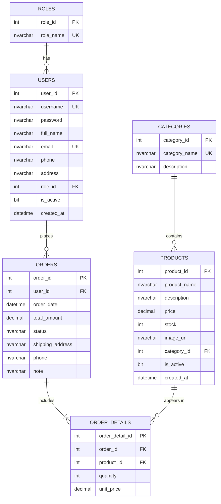

# Thiết kế cơ sở dữ liệu - Mini Product & Order Management

DBMS: Microsoft SQL Server. Database: `product_mgmt`.

## 1. Sơ đồ ERD (Mermaid)

## 2. Từ điển dữ liệu (Data Dictionary)

### Roles
| Cột | Kiểu dữ liệu | Khóa | Null | Mô tả |
|---|---|---|---|---|
| role_id | INT IDENTITY(1,1) | PK | NOT NULL | Mã vai trò |
| role_name | NVARCHAR(20) | UNIQUE | NOT NULL | ADMIN / CUSTOMER |

### Users
| Cột | Kiểu dữ liệu | Khóa | Null | Mô tả |
|---|---|---|---|---|
| user_id | INT IDENTITY(1,1) | PK | NOT NULL | Mã người dùng |
| username | NVARCHAR(50) | UNIQUE | NOT NULL | Tên đăng nhập |
| password | NVARCHAR(255) | | NOT NULL | Mật khẩu đã băm SHA-256 (hex thường) |
| full_name | NVARCHAR(100) | | NOT NULL | Họ tên |
| email | NVARCHAR(100) | UNIQUE | NOT NULL | Email |
| phone | NVARCHAR(15) | | NULL | Số điện thoại |
| address | NVARCHAR(255) | | NULL | Địa chỉ |
| role_id | INT | FK -> Roles(role_id) | NOT NULL | Vai trò |
| is_active | BIT | | NOT NULL | Mặc định 1 (còn hoạt động) |
| created_at | DATETIME | | NOT NULL | Mặc định GETDATE() |

### Categories
| Cột | Kiểu dữ liệu | Khóa | Null | Mô tả |
|---|---|---|---|---|
| category_id | INT IDENTITY(1,1) | PK | NOT NULL | Mã danh mục |
| category_name | NVARCHAR(100) | UNIQUE | NOT NULL | Tên danh mục |
| description | NVARCHAR(255) | | NULL | Mô tả |

### Products
| Cột | Kiểu dữ liệu | Khóa | Null | Mô tả |
|---|---|---|---|---|
| product_id | INT IDENTITY(1,1) | PK | NOT NULL | Mã sản phẩm |
| product_name | NVARCHAR(150) | | NOT NULL | Tên sản phẩm |
| description | NVARCHAR(MAX) | | NULL | Mô tả |
| price | DECIMAL(18,2) | | NOT NULL | Giá bán, CHECK >= 0 |
| stock | INT | | NOT NULL | Tồn kho, mặc định 0, CHECK >= 0 |
| image_url | NVARCHAR(255) | | NULL | Đường dẫn ảnh |
| category_id | INT | FK -> Categories(category_id) | NOT NULL | Danh mục |
| is_active | BIT | | NOT NULL | Xóa mềm, mặc định 1 |
| created_at | DATETIME | | NOT NULL | Mặc định GETDATE() |

### Orders
| Cột | Kiểu dữ liệu | Khóa | Null | Mô tả |
|---|---|---|---|---|
| order_id | INT IDENTITY(1,1) | PK | NOT NULL | Mã đơn hàng |
| user_id | INT | FK -> Users(user_id) | NOT NULL | Người đặt |
| order_date | DATETIME | | NOT NULL | Mặc định GETDATE() |
| total_amount | DECIMAL(18,2) | | NOT NULL | Tổng tiền, CHECK >= 0 |
| status | NVARCHAR(20) | | NOT NULL | PENDING, CONFIRMED, SHIPPING, COMPLETED, CANCELLED (mặc định PENDING) |
| shipping_address | NVARCHAR(255) | | NOT NULL | Địa chỉ giao hàng |
| phone | NVARCHAR(15) | | NOT NULL | SĐT nhận hàng |
| note | NVARCHAR(255) | | NULL | Ghi chú |

### OrderDetails
| Cột | Kiểu dữ liệu | Khóa | Null | Mô tả |
|---|---|---|---|---|
| order_detail_id | INT IDENTITY(1,1) | PK | NOT NULL | Mã chi tiết |
| order_id | INT | FK -> Orders(order_id), ON DELETE CASCADE | NOT NULL | Đơn hàng |
| product_id | INT | FK -> Products(product_id) | NOT NULL | Sản phẩm |
| quantity | INT | | NOT NULL | Số lượng, CHECK > 0 |
| unit_price | DECIMAL(18,2) | | NOT NULL | Giá tại thời điểm mua |

Ràng buộc bổ sung: UNIQUE (order_id, product_id) trong OrderDetails.

## 3. Tài khoản mẫu

> **Lưu ý bảo mật:** Các tài khoản mẫu này chỉ dùng để kiểm tra chức năng local. Mật khẩu được băm SHA-256 trước khi lưu vào CSDL. Khi triển khai thực tế, hãy thay đổi lại mật khẩu mặc định và **không lưu mật khẩu rõ ràng** trong kho mã nguồn.
